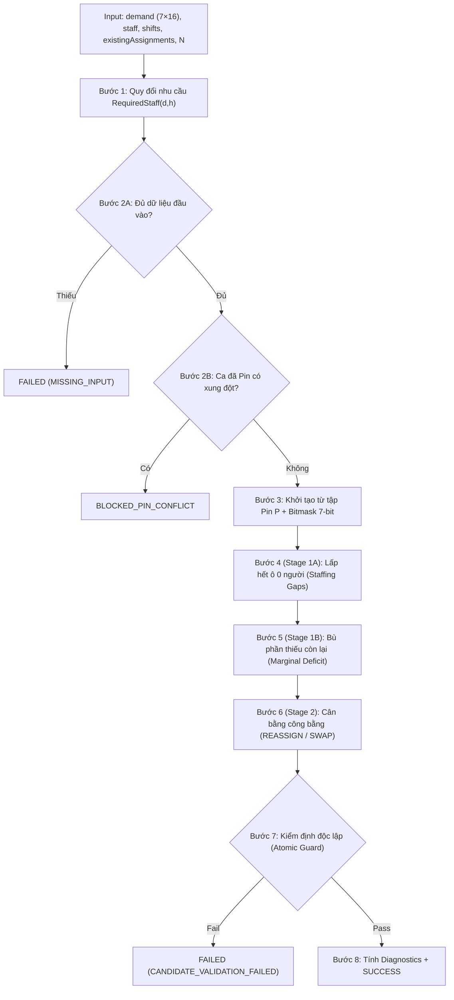

# Thuật toán Auto-Schedule — Playbook Nắm Vững & Phản Biện

> Tài liệu hợp nhất toàn bộ thuật toán hiện hành của sản phẩm (từ input → Stage 1 → Stage 2 → Validation → Diagnostics), khớp 100% với mã nguồn `src/domain/*`.
> Mục đích: **đọc để nắm chắc cơ chế, thuộc thứ tự ưu tiên, nhớ công thức, và trả lời sắc bén mọi câu hỏi phản biện.**

---

## 1. Tóm tắt 30 giây (Khung trả lời nhanh)

**Bài toán:** Cho nhu cầu khách theo lưới `7 ngày × 16 giờ (07:00–22:59)`, danh sách ca mẫu (có ngày hoạt động) và nhân viên (có quỹ giờ tuần & ngày nghỉ), tự động gán `(ngày, ca, nhân viên)`.

**Bản chất thuật toán:** **Heuristic tham lam xác định 2 tầng** (*Deterministic Two-Stage Greedy + Local Search*):
1. **Ràng buộc cứng là bất khả xâm phạm** (quỹ giờ, tối đa 1 ca/ngày, ngày nghỉ, ngày ca hoạt động, bảo toàn nguyên vẹn ca đã Pin).
2. **Stage 1 — Tối đa hóa Độ phủ (Coverage first):** Xóa hết các giờ *không có ai trực* (1A) → bù tiếp các giờ *thiếu người* theo hiệu suất cao nhất (1B). Khi chọn người, ưu tiên **giữ tài nguyên linh hoạt & đóng gói khít quỹ giờ** (MRV → Best-Fit → Jain).
3. **Stage 2 — Tối ưu Công bằng bảo toàn Độ phủ (Fairness second):** Chỉ đổi người giữ ca (`REASSIGN` / `SWAP`) để đẩy **Jain's Fairness Index** lên cao nhất mà **không làm thay đổi lưới nhân sự 112 ô dù chỉ 1 người-giờ**.

---

## 2. Từ điển Ký hiệu & Khái niệm

| Tên gọi | Ký hiệu | Ý nghĩa |
|---|---|---|
| Ngày / Giờ | $d \in \{0..6\},\ h \in \{7..22\}$ | `0 = Mon .. 6 = Sun`; `h` là khung `[h:00, h+1:00)` (tổng `7×16 = 112` ô) |
| Ca mẫu | $s$, $H(s)$, $\text{dur}(s)$ | $H(s) = \{h \mid s.\text{start} \le h < s.\text{end}\}$, độ dài $\text{dur}(s) = s.\text{end} - s.\text{start}$ |
| Ngưỡng năng suất | $N$ | `targetTxnsPerStaffHour` — số giao dịch mục tiêu / 1 NV / 1 giờ (mặc định `15`, miền `[1, 500]`) |
| Giao dịch / Cần / Hiện có | $\text{Txn}(d,h),\ \text{Req}(d,h),\ \text{SH}(d,h)$ | Giao dịch, nhân sự cần, nhân sự đang trực tại ô $(d,h)$ |
| Nhân viên đủ điều kiện | $E$ | Nhân viên có $M_i > 0$ **và** có ít nhất 1 ngày khả dụng (không nghỉ đủ 7 ngày) |
| Quỹ giờ & Tỷ lệ dùng | $A_i,\ M_i,\ u_i = A_i / M_i$ | `assignedHours`, `maxWeeklyHours`, và `utilization` của nhân viên $i \in E$ |
| Tập Pin | $P$ | Các phân công Manager đã ghim (`isPinned = true`) — bất biến |
| Đơn vị `staff-hour` | — | 1 nhân viên làm trong 1 ô giờ (tổng thiếu/dư cộng gộp trên 112 ô, không phải số giờ đồng hồ) |

---

## 3. Thuật toán hoạt động từng bước

### Bước 1 — Quy đổi Nhu cầu theo Giờ (`Txn → Req`)

**Làm gì:** Biến ma trận giao dịch `7×16` thành số nhân viên cần cho từng ô 1 giờ.

**Công thức:**

$$
\text{Req}(d,h) = \begin{cases}
0 & \text{nếu } \text{Txn}(d,h) = 0 \\[4pt]
\left\lceil \dfrac{\text{Txn}(d,h)}{N} \right\rceil & \text{nếu } \text{Txn}(d,h) > 0
\end{cases}
$$

- Ví dụ ($N = 15$): `0 → 0`, `1 → 1`, `15 → 1`, `16 → 2`, `30 → 2`, `31 → 3`.
- **Chống sai số số thực IEEE-754:** Không dùng `Math.ceil(txn / N)` (vì `21 / 1.4 = 15.000000000000002` → làm tròn nhầm thành `16`). Code tách $N$ thành phân số nguyên `num / den` bằng `BigInt` rồi tính:

$$
\text{Req} = \left\lfloor \frac{\text{num} + \text{den} - 1}{\text{den}} \right\rfloor
$$

**Vì sao làm tròn lên theo từng giờ?** Nhân sự là số nguyên và lịch chia theo ô 1 giờ: chỉ cần có 1 khách giao dịch vẫn phải có tối thiểu 1 người trực. Làm tròn lên tự động đảm bảo $\text{Req} \ge 1$ khi $\text{Txn} > 0$ mà không cần thêm luật đặc biệt.

---

### Bước 2 — Hai Cổng Tiền Kiểm (Fail-Fast, Không Sửa Lịch)

#### 2A. Input Readiness Gate
Chỉ chạy khi đủ cả 4 điều kiện (thiếu → `FAILED / MISSING_INPUT`):
1. `demand !== null` (đủ 112 ô hợp lệ).
2. `shifts.length > 0`.
3. Tập nhân viên đủ điều kiện $E \ne \emptyset$, với:
   $$E = \{\, i \in \text{staff} \mid M_i > 0 \ \land\ \text{unavailableDays}_i.\text{length} < 7 \,\}$$
4. $N$ hữu hạn và $N \in [1, 500]$.

#### 2B. Pin Conflict Gate
Kiểm tra riêng tập đã Pin $P$. Nếu có bất kỳ vi phạm nào → dừng ngay, trả `BLOCKED_PIN_CONFLICT` kèm danh sách chi tiết; **tuyệt đối không tự gỡ Pin**:
- `OVER_MAX_HOURS`: tổng giờ hợp duy nhất của $P$ cho nhân viên $i$ vượt $M_i$.
- `MULTIPLE_SHIFTS_SAME_DAY`: nhân viên có $\ge 2$ ca Pin trong cùng 1 ngày.
- `OVERLAPPING_SHIFTS`: 2 ca Pin cùng ngày chồng lấn khoảng `[startHour, endHour)`.
- `UNAVAILABLE_DAY`: ca Pin rơi vào ngày nhân viên đánh dấu nghỉ.

**Vì sao?** Pin là ý chí rõ ràng của Manager; bộ giải không được quyền "đoán" nên hủy ca Pin nào.

---

### Bước 3 — Khởi tạo Trạng thái & Tiền xử lý Bitmask

1. **Khởi tạo từ $P$:** Sao chép nguyên vẹn tập Pin $P$; dựng sẵn lưới $\text{SH}(d,h)$, `assignedHours[i]`, `dayOccupied[i, d]`.
2. **Sắp xếp cố định để đảm bảo tính xác định:**
   - Ca mẫu (`sortedShifts`): `(startHour ASC, endHour ASC, id ASC)`.
   - Nhân viên đủ điều kiện (`eligibleStaff`): `id ASC`.
3. **Tích lũy sẵn tổng Jain:** $\Sigma u = \sum_{i \in E} u_i$ và $\Sigma u^2 = \sum_{i \in E} u_i^2$ để mọi phép đánh giá Jain về sau chạy **O(1)**.
4. **Dựng Bitmask 7-bit (O(1) trong vòng lặp nóng):**

$$
\text{shiftDayMask}_s = \sum_{d \in \text{daysOfWeek}(s)} 2^d \qquad\qquad
\text{unavailableMask}_i = \sum_{d \in \text{unavailableDays}(i)} 2^d
$$

   - `daysOfWeek` bỏ trống → mặc định `0x7F` (cả 7 ngày); `unavailableDays` bỏ trống → `0` (sẵn sàng cả 7 ngày).
   - **Lưu riêng `unavailableMask` và `dayOccupied`:** Tuyệt đối không ghi trộn ngày nghỉ vào `dayOccupied`, vì ở Stage 2 khi chuyển ca đi, code xóa `dayOccupied[i, d] = 0` — trộn chung sẽ làm mất ngày nghỉ.

---

### Bước 4 & 5 — Stage 1: Xây dựng Độ phủ (Greedy Construction)

**Nguyên tắc cốt lõi — Thiếu hụt biên theo giờ (Hourly Marginal Deficit):**
Hệ thống **không** quy đổi tĩnh *"ca sáng cần 3 người, ca trưa cần 2 người"* trước khi xếp, vì khi cửa hàng có các ca chồng lấn (`07–15`, `11–15`, `15–23`), tính độc lập sẽ **đếm trùng** nhu cầu vùng giao `11–15` gây thừa người. Thay vào đó, ở mỗi bước lặp, thuật toán chấm điểm lại **động** mọi cặp `(ngày d, ca s)` đang hoạt động trên ngày $d$ (`(shiftDayMask[s] & (1 << d)) ≠ 0`):

$$
\text{deficit}(d,h) = \max\big(0,\ \text{Req}(d,h) - \text{SH}(d,h)\big)
$$

| Chỉ số ứng viên $(d,s)$ | Công thức | Ý nghĩa trực giác |
|---|---|---|
| **Số ô trống được lấp** ($\Delta\text{gaps}$) | $\big\lvert\{h \in H(s) \mid \text{Req}(d,h) > 0 \land \text{SH}(d,h) = 0\}\big\rvert$ | Bao nhiêu giờ **0 người** sẽ được cứu |
| **Giờ thiếu được bù** ($\Delta\text{cov}$) | $\big\lvert\{h \in H(s) \mid \text{deficit}(d,h) > 0\}\big\rvert$ | Bao nhiêu `staff-hour` thiếu được giảm đi 1 khi thêm 1 người |
| **Hiệu suất phủ** ($\text{efficiency}$) | $\dfrac{\Delta\text{cov}(d,s)}{\text{dur}(s)} \in [0, 1]$ | Tỷ lệ giờ **có ích** của ca (`1 - efficiency` là tỷ lệ giờ thừa) |
| **Áp lực giao dịch** ($\text{pressure}$) | $\displaystyle\sum_{h \in H(s),\ \text{deficit}(d,h)>0} \frac{\text{Txn}(d,h)}{\max(1,\ \text{SH}(d,h))}$ | Độ "nghẽn" — mật độ đơn/người tại các giờ đang thiếu |

#### Bước 4 (Stage 1A) — Xóa Lỗ hổng Không Người (`Staffing Gaps`)
Lặp chừng nào còn $(d,s)$ có $\Delta\text{gaps} > 0$ **và** có ít nhất 1 nhân viên hợp lệ.

| Thứ tự ưu tiên chọn ca $(d,s)$ | Hướng | Vì sao? |
|---|---|---|
| 1. $\Delta\text{gaps}$ | **Lớn nhất** | Giờ có khách mà **0 người trực** là lỗi vận hành nặng nhất. 1 nhân viên lấp được càng nhiều giờ trống càng tốt. |
| 2. $\text{efficiency}$ | **Lớn nhất** | Cùng số ô trống → chọn ca ít giờ thừa hơn để tiết kiệm quỹ giờ. |
| 3. $\text{pressure}$ | **Lớn nhất** | Hòa nữa → cứu khung giờ đông khách nhất trước. |
| 4. Tie-break xác định | `(d, startHour, endHour, shift.id)` ASC | Đảm bảo chạy lại luôn ra cùng kết quả. |

#### Bước 5 (Stage 1B) — Bù Thiếu hụt Còn lại (`Marginal Deficit`)
Sau khi không còn ô 0 người nào cứu được nữa, lặp chừng nào còn $(d,s)$ có $\Delta\text{cov} > 0$ **và** có nhân viên hợp lệ.

| Thứ tự ưu tiên chọn ca $(d,s)$ | Hướng | Vì sao? |
|---|---|---|
| 1. $\text{efficiency}$ | **Lớn nhất** | Giờ nào cũng đã có người rồi; lúc này ưu tiên **dùng quỹ giờ hiệu quả nhất, ít tạo giờ thừa nhất**. Tự động ưu tiên ca ngắn/ca gối đầu khớp giờ cao điểm (VD chỉ `11–15` thiếu → ca `11–15` đạt `4/4 = 1.0`, thắng ca `07–15` chỉ `4/8 = 0.5`). |
| 2. $\Delta\text{cov}$ | **Lớn nhất** | Cùng hiệu suất (VD cùng `100%`) → chọn ca dài hơn vì bù được nhiều giờ thiếu hơn (8h thắng 4h). |
| 3. $\text{pressure}$ | **Lớn nhất** | Bảo vệ khung giờ căng thẳng nhất trước. |
| 4. Tie-break xác định | `(d, startHour, endHour, shift.id)` ASC | Xác định. |

**Điều kiện dừng Stage 1:** Không còn $(d,s)$ có $\Delta\text{cov} > 0$ hoặc hết nhân viên hợp lệ. **Không bao giờ** xếp thêm ca vào giờ đã đủ người chỉ để tiêu hết quỹ giờ hợp đồng.

#### Cách Chọn Nhân viên cho $(d,s)$ — `pickBestFitStaff(d, s)`

**Điều kiện hợp lệ (bắt buộc thỏa cả 3):**

$$
\text{dayOccupied}_{i,d} = 0 \quad\land\quad (\text{unavailableMask}_i \,\&\, 2^d) = 0 \quad\land\quad A_i + \text{dur}(s) \le M_i
$$

**Thứ tự ưu tiên trong số nhân viên hợp lệ:**

| # | Tiêu chí | Công thức | Hướng | Vì sao? |
|---|---|---|---|---|
| **1** | **MRV** *(ít ngày khả dụng nhất)* | $\text{availDays}_i = 7 - \text{popcount}(\text{unavailableMask}_i)$ | **Nhỏ nhất** | *Minimum Remaining Values*: người có ít ngày đi làm được là tài nguyên "khó xếp" — dùng họ ngay vào ngày họ rảnh, để **giữ người rảnh cả tuần** cho những ngày khan hiếm khác. (Nếu mọi người đều rảnh 7 ngày, tiêu chí này hòa và rơi xuống tiêu chí 2). |
| **2** | **Best-Fit** *(quỹ giờ dư ít nhất)* | $\text{slack}_i = M_i - (A_i + \text{dur}(s))$ | **Nhỏ nhất** | *Bin-packing*: nhét ca vào người vừa khít quỹ giờ nhất, tránh "đốt" quỹ của người full-time 40h vào ca lẻ 4h khiến các ca dài 8h về sau không còn ai nhận. Công bằng để Stage 2 lo. |
| **3** | **Jain Index giả định** | $J'$ sau khi thử gán (tính O(1)) | **Lớn nhất** ($\varepsilon = 10^{-9}$) | Khi hòa MRV và slack → chọn người giúp phân bố tỷ lệ đều hơn. |
| **4** | `staff.id` | — | **ASC** | Tie-break xác định. |

---

### Bước 6 — Stage 2: Cân bằng Công bằng Bảo toàn Độ phủ

#### Mục tiêu: Jain's Fairness Index trên tỷ lệ sử dụng quỹ giờ

$$
J(u) = \frac{\left(\sum_{i \in E} u_i\right)^2}{|E| \cdot \sum_{i \in E} u_i^2}, \qquad u_i = \frac{A_i}{M_i}, \qquad J \in \left[\frac{1}{|E|},\ 1\right]
$$

- $J = 1.0$: mọi nhân viên dùng **cùng % quỹ giờ** (VD người 40h làm 32h = 80%, người 20h làm 16h = 80%).
- $J$ càng nhỏ: phân bổ càng lệch (VD 3 người dùng `100%, 50%, 50%` → $J = 2^2 / (3 \times 1.5) \approx 0.889$).
- Nếu $|E| = 0$ hoặc $\sum u_i = 0$ → `null` (UI hiện `–`).

#### 6 Bất biến bảo toàn độ phủ 100%
1. Không thêm, không xóa assignment nào.
2. Không đổi `id`, `day`, `shiftId`, `isPinned`.
3. Chỉ đổi `staffId` của assignment **chưa Pin** ($U$).
4. Số lượng assignment ở mỗi cặp `(day, shiftId)` giữ nguyên tuyệt đối.
5. Mọi nước đi phải thỏa toàn bộ ràng buộc cứng (quỹ giờ, 1 ca/ngày, ngày nghỉ).
6. Vi phạm → loại bỏ.

$$\implies \forall (d,h):\ \text{SH}_{\text{trước}}(d,h) = \text{SH}_{\text{sau}}(d,h)$$

Toàn bộ `demandCoverage`, `shortageHours`, `overstaffedHours`, `staffingGapCount` **giữ nguyên chính xác 100%**.

#### Hai phép biến đổi & Đánh giá O(1)

Đầu mỗi vòng lặp, dựng 1 lần mặt nạ "ngày bận" cho từng nhân viên:

$$
\text{dayMask}_i = \text{unavailableMask}_i \ \big|\ \bigvee_{d:\ \text{dayOccupied}_{i,d} = 1} 2^d
$$

→ Một phép bit `(dayMask[i] & (1 << d)) !== 0` kiểm đồng thời cả *"đã có ca ngày d"* lẫn *"nghỉ ngày d"*.

Danh sách ca chưa Pin $U$ đã được sắp cố định theo `stableKey = (day, startHour, endHour, shiftId, initialStaffId, ordinal)` ASC.

| Phép biến đổi | Cơ chế | Điều kiện hợp lệ | Đổi giờ |
|---|---|---|---|
| **1. `REASSIGN`** | Chuyển ca $a$ (ngày $d$, dài $\ell$) từ người $i$ sang người $e$ | $e \ne i$, $(\text{dayMask}_e \,\&\, 2^d) = 0$, $A_e + \ell \le M_e$ | $A_i \mathrel{-}= \ell$, $A_e \mathrel{+}= \ell$ |
| **2. `SWAP`** | Đổi người giữa $a_1$ (ngày $d_1$, dài $\ell_1$, người $i$) và $a_2$ (ngày $d_2$, dài $\ell_2$, người $j$) | $\ell_1 \ne \ell_2$, $i \ne j$; nếu $d_1 \ne d_2$: $(\text{dayMask}_i \,\&\, 2^{d_2}) = 0$ và $(\text{dayMask}_j \,\&\, 2^{d_1}) = 0$; $A_i - \ell_1 + \ell_2 \le M_i$, $A_j - \ell_2 + \ell_1 \le M_j$ | $A_i \mathrel{+}= \ell_2 - \ell_1$, $A_j \mathrel{+}= \ell_1 - \ell_2$ |

**Công thức tính $\Delta J$ trong O(1)** (chỉ trừ đi đóng góp cũ và cộng đóng góp mới của 1–2 người bị ảnh hưởng):

$$
\Sigma u' = \Sigma u - \sum_{k} u_k + \sum_{k} u_k', \qquad
\Sigma u^{2\,\prime} = \Sigma u^2 - \sum_{k} u_k^2 + \sum_{k} (u_k')^2, \qquad
\Delta J = \frac{(\Sigma u')^2}{|E| \cdot \Sigma u^{2\,\prime}} - J_{\text{curr}}
$$

Sau khi **áp dụng** nước đi thắng cuộc, gọi `recomputeUtilizationSums` tính lại $\Sigma u, \Sigma u^2$ từ đầu trong $O(|E|)$ để **triệt tiêu hoàn toàn sai số trôi số thực tích lũy**.

#### Quy tắc chọn nước đi & Dừng
- **Bỏ qua (`SKIPPED`):** nếu $|E| \le 1$ hoặc $|U| = 0$.
- **Steepest Ascent:** Chỉ nhận nước đi có $\Delta J > 10^{-6}$ (`REBALANCE_IMPROVE_EPS`), chọn nước có $\Delta J$ **lớn nhất**.
- **Tie-break (khi $|\Delta J_1 - \Delta J_2| \le 10^{-9}$):** `REASSIGN` ưu tiên trước `SWAP`, rồi theo thứ tự duyệt `stableKey ASC` và `staff.id ASC`.
- **Dừng:** Không còn nước đi nào có $\Delta J > 10^{-6}$ (`CONVERGED`), hoặc chạm trần `MAX_REBALANCE_ITERATIONS = 200` (`MAX_ITERATIONS_REACHED`).

---

### Bước 7 — Kiểm định Độc lập (Atomic Commit)

Sau khi gán `id` cho các assignment mới (theo thứ tự `stableKey ASC` từ `idGenerator`), chạy `validateCandidateAssignments` độc lập với bộ giải, xác minh đủ:
1. Tập Pin $P$ giữ nguyên từng phần tử.
2. Không trùng `id` và không trùng bộ ba `(day, shiftId, staffId)`.
3. Tham chiếu `staffId`, `shiftId` tồn tại; mọi assignment mới có `isPinned = false`.
4. Thỏa toàn bộ ràng buộc cứng: quỹ giờ, $\le 1$ ca/ngày, không chồng giờ, ca hoạt động ngày đó, nhân viên không nghỉ ngày đó.
5. Lưới `StaffHours` sau Stage 2 **khớp từng ô một** với snapshot sau Stage 1.

Bất kỳ điều kiện nào fail → trả `FAILED / CANDIDATE_VALIDATION_FAILED`, **lịch cũ nguyên vẹn 100%**.

---

### Bước 8 — Chỉ số Chẩn đoán (Diagnostics & Health Bar)

| Chỉ số | Công thức | Ý nghĩa / Lưu ý |
|---|---|---|
| `totalRequiredStaffHours` ($T$) | $\sum_{d,h} \text{Req}(d,h)$ | Tổng nhu cầu tuần (`staff-hours`) |
| `coveredRequiredStaffHours` ($C$) | $\sum_{d,h} \min(\text{SH}, \text{Req})$ | Phần nhu cầu đã phủ (dư ở giờ này **không bù** thiếu ở giờ khác) |
| `demandCoverage` | $C / T$ (`null` nếu $T = 0$) | Good $\ge 90\%$, Attention $75\%\text{–}<90\%$, Warning $<75\%$ |
| `shortageHours` | $\sum_{d,h} \max(0, \text{Req} - \text{SH}) = T - C$ | Tổng thiếu hụt |
| `uncoverableRequiredStaffHours` | $\sum_{\text{cellCoverable}(d,h)=0} \max(0, \text{Req} - \text{SH})$ | Thiếu do **không có ca mẫu nào** hoạt động phủ ô $(d,h)$ đó |
| `residualCoverableShortageHours` | `shortageHours − uncoverable` | Thiếu tại các ô **có ca phủ** nhưng chưa xếp được (hết người/quỹ giờ/ngày nghỉ) |
| `overstaffedHours` | $\sum_{d,h} \max(0, \text{SH} - \text{Req})$ | Giờ xếp dư **trên sàn** vượt nhu cầu |
| `unusedCapacityHours` | $\sum_{i \in E} \max(0, M_i - A_i)$ | Quỹ giờ **hợp đồng** chưa dùng |
| `staffingGapCount` | $\lvert\{(d,h) : \text{Txn} > 0 \land \text{SH} = 0\}\rvert$ | Số ô có khách nhưng **0 người trực** (Good = `0`, Warning `> 0`) |
| `fairnessJainIndex` | $J(u)$ trên $E$ | Good $\ge 0.90$, Attention $0.80\text{–}<0.90$, Warning $< 0.80$ |

Với lưới 2D `cellCoverable(d, h) = 1` khi và chỉ khi tồn tại ca $s$ có `(shiftDayMask[s] & (1 << d)) ≠ 0` và $h \in H(s)$.

---

## 4. Ví dụ chạy tay (Whiteboard trong 2 phút)

**Bối cảnh giả lập (1 ngày Thứ 2, khung 07:00–15:00, $N = 15$):**
- **Nhu cầu (`Txn → Req`):**
  - `07:00–11:00` (4 giờ sáng): `12` đơn/giờ → $\text{Req} = \lceil 12/15 \rceil = \mathbf{1}$ người/giờ.
  - `11:00–15:00` (4 giờ trưa cao điểm): `28` đơn/giờ → $\text{Req} = \lceil 28/15 \rceil = \mathbf{2}$ người/giờ.
  - Tổng nhu cầu: $4\times 1 + 4\times 2 = \mathbf{12}$ `staff-hours`.
- **Ca mẫu (đều bật Thứ 2):**
  - `S1`: `07:00–15:00` (8h)
  - `S2`: `11:00–15:00` (4h)
- **Nhân viên (chưa có ca nào):**
  - **An:** max `20h`, rảnh **7/7** ngày.
  - **Bình:** max `12h`, rảnh **7/7** ngày.
  - **Chi:** max `12h`, nghỉ 5 ngày → rảnh **2/7** ngày (trong đó có Thứ 2).

**Chạy từng bước:**

1. **Stage 1A — Lấp ô 0 người (8 ô đang có $\text{SH} = 0$):**
   - `S1` (8h): $\Delta\text{gaps} = 8$, $\text{efficiency} = 8/8 = 1.0$.
   - `S2` (4h): $\Delta\text{gaps} = 4$, $\text{efficiency} = 4/4 = 1.0$.
   - → **Chọn `S1`** vì $\Delta\text{gaps}$ lớn hơn (`8 > 4`).
   - **Chọn người cho `S1` (8h):** cả 3 đều hợp lệ (`8 ≤ max`).
     - MRV: **Chi** chỉ rảnh `2/7` ngày (< An `7/7`, Bình `7/7`) → **Chọn Chi**! (Giữ An & Bình linh hoạt cho các ngày khác).
   - *Sau bước 1:* `07–11` đã đủ (`1/1`), `11–15` còn thiếu 1 người/giờ (`1/2`). Không còn ô 0 người nào → **Xong Stage 1A**.

2. **Stage 1B — Bù thiếu hụt còn lại (`11–15` thiếu 4 `staff-hours`):**
   - `S1` (8h): $\Delta\text{cov} = 4$, $\text{efficiency} = 4/8 = \mathbf{0.50}$ (tạo 4h thừa buổi sáng).
   - `S2` (4h): $\Delta\text{cov} = 4$, $\text{efficiency} = 4/4 = \mathbf{1.00}$ (0h thừa!).
   - → **Chọn `S2`** nhờ `efficiency` vượt trội (`1.0 > 0.5`).
   - **Chọn người cho `S2` (4h):** Chi đã có ca Thứ 2 (loại). Còn An (`20h`) và Bình (`12h`), đều rảnh `7/7` ngày (hòa MRV).
     - Best-Fit slack: Bình còn dư `12 - 4 = 8h`; An còn dư `20 - 4 = 16h`.
     - → **Chọn Bình** (slack nhỏ hơn, giữ nguyên quỹ 20h của An cho các ca 8h ngày khác).
   - *Sau Stage 1:* Độ phủ = **100%** (`12/12`), `0` giờ thừa!
     - Tỷ lệ dùng quỹ: Chi `8/12 = 66.7%`, Bình `4/12 = 33.3%`, An `0/20 = 0%`.
     - $J = \frac{(0.667 + 0.333 + 0)^2}{3 \times (0.444 + 0.111 + 0)} = \frac{1}{1.667} = \mathbf{0.600}$.

3. **Stage 2 — Cân bằng công bằng (giữ nguyên `S1` và `S2`):**
   - Thử `REASSIGN` `S2` (4h) từ Bình sang An:
     - Tỷ lệ mới: Chi `66.7%`, Bình `0%`, An `4/20 = 20%` → $J = 0.517$ (giảm, loại).
   - Thử `REASSIGN` `S1` (8h) từ Chi sang An:
     - Tỷ lệ mới: Chi `0%`, Bình `33.3%`, An `8/20 = 40%` → $J = \frac{0.733^2}{3 \times 0.271} = \mathbf{0.661}$ ($\Delta J = +0.061 > 10^{-6}$ ✅).
   - Các bước khác không tăng thêm được → **Áp dụng `REASSIGN` (Chi → An)** và hội tụ (`CONVERGED`).
   - *Kết quả cuối:* Độ phủ vẫn **100%** (`07–11`: 1 người, `11–15`: 2 người), `overstaffed = 0`, Jain tăng từ `0.600 → 0.661`, không vi phạm ràng buộc nào. *(Trong thực tế 7 ngày nhiều ca, Stage 2 sẽ kéo Jain lên > 0.95).*

---

## 5. Bộ Câu hỏi Tấn công & Cách Trả lời (Defense Playbook)

### A. Kiến trúc & Lựa chọn Thuật toán

**Q1: Tại sao dùng Greedy 2 tầng mà không dùng ILP / MILP / CP-SAT để ra nghiệm tối ưu toàn cục?**
- **Trả lời:** Bài toán chạy **100% client-side trên trình duyệt**, tương tác đồng bộ khi Manager chỉnh `N`, thêm ca, sửa ngày nghỉ (mục tiêu `< 50 ms`).
  - ILP/CP-SAT cần solver nặng (WASM/backend), khó giải thích từng bước cho Manager, và thường không deterministic giữa các bản build/timeout.
  - Greedy 2 tầng: (1) chạy chỉ vài ms thuần JS với TypedArray, (2) **deterministic 100%**, (3) **explainable** — giải thích được từng quyết định (vì sao chọn ca này, vì sao chọn người này), phù hợp sản phẩm hỗ trợ Manager ra quyết định.
  - Đánh đổi đã tuyên bố rõ: không cam kết tối ưu toàn cục trong mọi tổ hợp ràng buộc phức tạp, nhưng thực tế với cửa hàng 7 ngày × 2–6 ca × 10–30 NV chất lượng rất sát tối ưu.

**Q2: Tại sao không tối ưu Độ phủ và Công bằng cùng lúc (ví dụ hàm mục tiêu trọng số `w1 * Coverage + w2 * Fairness`)?**
- **Trả lời:** Hàm trọng số tuyến tính rất dễ gây **đánh đổi ngầm nguy hiểm**: solver có thể cố tình *bỏ trống 1 giờ đông khách* chỉ để điểm Fairness đẹp hơn, hoặc ngược lại rất nhạy cảm với việc chọn `w1, w2` theo từng cửa hàng.
- Tách thành **2 tầng theo thứ tự từ điển (lexicographic)**: Stage 1 khóa chặt mục tiêu nghiệp vụ số 1 (*đủ người phục vụ khách*), Stage 2 chỉ cải thiện công bằng trong không gian nghiệm **giữ nguyên 100% độ phủ**. Không cần tinh chỉnh trọng số mà vẫn đảm bảo nguyên tắc vận hành.

**Q3: Stage 1B nếu cửa hàng chỉ có ca 8h (`07–15`) mà chỉ 1 giờ trưa `12:00` thiếu 1 người, nó vẫn xếp thêm 1 người làm cả 8h (dư 7h) à? Có lãng phí không?**
- **Trả lời:** **Có, và đây là đánh đổi có chủ đích** (*Fixed-Shift Spillover Trade-off*):
  1. Thuật toán chỉ ưu tiên các ca có `efficiency` cao hơn trước; chỉ khi *không còn ca nào hiệu suất tốt hơn* nó mới xếp ca 8h đó (`efficiency = 1/8 = 12.5%`).
  2. Tinh thần bài toán là không để giờ cao điểm bị thiếu người khi vẫn còn nhân lực hợp lệ.
  3. Hệ thống lập tức báo rõ số `overstaffedHours` (7h) trong Diagnostics/Banner để Manager thấy và chủ động thêm một ca gối đầu ngắn (VD `11–15`). Bộ giải không tự bịa ra ca mới ngoài `ShiftTemplate` của Manager.

**Q4: Tại sao không dùng `Fairness` làm tiêu chí chọn người số 1 ở Stage 1 luôn?**
- **Trả lời:** Nếu chia đều ngay từ Stage 1, các ca ngắn/dễ sẽ bị rải đều cho cả nhân viên full-time (40h) lẫn người rảnh cả tuần → đến cuối Stage 1, quỹ giờ bị **phân mảnh (fragmentation)**, ví dụ 4 người mỗi người còn dư 4h nhưng cần xếp một ca 8h thì không ai nhận được → **rớt độ phủ**.
- Vì vậy Stage 1 chọn **MRV → Best-Fit** để *tối đa hóa khả năng nhét đủ ca* (giống bin-packing), rồi Stage 2 mới san đều lại mà không làm vỡ độ phủ.

---

### B. Toán học & Công thức

**Q5: Tại sao quy đổi nhu cầu bằng `ceil(Txn / N)` theo từng giờ mà không tính theo từng ca (max hoặc trung bình)?**
- **Trả lời:**
  - Nếu lấy **trung bình theo ca**: che giấu đỉnh cao điểm (VD 3 giờ có 5 đơn, 1 giờ có 45 đơn → TB = 15 → chỉ xếp 1 người, giờ cao điểm vỡ trận).
  - Nếu lấy **max theo ca** trước khi xếp: khi có ca chồng lấn (`07–15` và `11–15`), cả hai ca đều nhìn thấy đỉnh trưa và **đếm trùng nhu cầu** → xếp gấp đôi người cần thiết.
  - Tính `ceil` theo từng ô 1 giờ + chấm điểm **Hourly Marginal Deficit** vừa bắt đúng đỉnh cao điểm, vừa không đếm trùng khi ca chồng lấn.

**Q6: Tại sao phải dùng `BigInt` để tính `ceil(Txn / N)`? `Math.ceil(txn / N)` có vấn đề gì?**
- **Trả lời:** `N` cho phép số thập phân trong `[1, 500]` (VD `1.4`, `12.5`). Trong IEEE-754 float64, `21 / 1.4 = 15.000000000000002` → `Math.ceil` ra **`16` thay vì `15`** (tạo thêm 1 nhân viên ma mỗi giờ chỉ vì lỗi dấu phẩy động!).
- Dùng `epsilon` tùy ý (kiểu `Math.ceil(x - 1e-9)`) rất rủi ro vì có thể làm tròn sai những phân số thực sự lớn hơn số nguyên một lượng nhỏ. Tách `N` thành phân số nguyên `BigInt` rồi chia nguyên `(num + den - 1n) / den` là **chính xác tuyệt đối về mặt toán học**.

**Q7: Tại sao dùng Jain's Fairness Index trên tỷ lệ `u_i = assigned / max`, thay vì phương sai/độ lệch chuẩn của số giờ?**
- **Trả lời:**
  1. **Công bằng theo hợp đồng:** Nhân viên part-time `20h` làm `16h` (`80%`) và full-time `40h` làm `32h` (`80%`) là công bằng — so giờ tuyệt đối sẽ sai bản chất.
  2. **Chuẩn hóa & dễ hiểu:** Jain Index luôn nằm trong `[1/|E|, 1]`, bất biến theo thang đo (`u` nhân hằng số dương thì $J$ không đổi), dễ gắn ngưỡng UX (`≥ 0.90` Good).
  3. **Tối ưu hiệu năng O(1):** $J$ chỉ phụ thuộc vào 2 đại lượng cộng dồn $\Sigma u$ và $\Sigma u^2$, nên đánh giá 1 nước `REASSIGN`/`SWAP` chỉ tốn vài phép cộng/nhân O(1), không cần duyệt lại toàn bộ nhân viên.

**Q8: Tại sao trong Stage 2, phép `SWAP` chỉ xét 2 ca *khác thời lượng* (`l1 ≠ l2`)?**
- **Trả lời:** Nếu 2 ca có cùng thời lượng ($\ell_1 = \ell_2$), sau khi hoán đổi thì `assignedHours` của cả hai nhân viên **không đổi** → $u_1, u_2$ không đổi → $\Delta J = 0$. Xét chúng chỉ tốn thêm vòng lặp $O(|U|^2)$ vô ích.

**Q9: Đã có `REASSIGN` rồi, tại sao cần thêm `SWAP`?**
- **Trả lời:** Khi lịch đã dày (mọi người đều đã có ca vào các ngày đó, hoặc sát trần `maxWeeklyHours`), `REASSIGN` bị chặn vì người nhận hoặc đã có ca ngày đó hoặc cộng thêm cả ca sẽ vượt trần.
- `SWAP` giữa 2 ca khác thời lượng (VD đổi ca 8h lấy ca 4h) chỉ dịch chuyển **hiệu số `|l1 - l2| = 4h`** giữa hai người mà vẫn giữ mỗi người đúng 1 ca/ngày → mở khóa được các bước cải thiện công bằng mà `REASSIGN` đơn lẻ bị kẹt.

**Q10: Stage 2 chỉ là Hill-Climbing (local search), có bị kẹt ở cực trị địa phương (local optimum) không?**
- **Trả lời:** **Có thể** — ví dụ cần chuỗi đổi 3 bên (`A → B → C`) mới tăng $J$, trong khi mỗi bước 2 bên không tăng. Nhưng:
  - Không gian nghiệm nhỏ (thường 20–100 assignment), `REASSIGN + SWAP` đã bao phủ phần lớn các trường hợp mất cân bằng thực tế và đẩy Jain lên `0.95–1.00`.
  - Giữ độ phức tạp dự đoán được ($O(|U|^2)$ mỗi vòng, tối đa 200 vòng), chạy cực nhanh và dễ giải thích từng bước cho Manager.

---

### C. Ràng buộc & Trường hợp Biên

**Q11: Tại sao Stage 1 chọn nhân viên theo `MRV` trước `Best-Fit`?**
- **Trả lời:** MRV (*Minimum Remaining Values* — heuristic kinh điển trong bài toán thỏa mãn ràng buộc CSP): giả sử Chi chỉ đi làm được Thứ 2 & Thứ 3, còn An đi làm được cả 7 ngày. Nếu Thứ 2 ta gán An trước (vì Best-Fit), đến Thứ 4 khi thiếu người thì Chi nghỉ còn An đã hết quỹ giờ → bỏ lỡ độ phủ.
- Ưu tiên người ít ngày khả dụng trước giúp **bảo tồn sự linh hoạt** của nhóm rảnh nhiều ngày. Đặc biệt: nếu tất cả nhân viên đều rảnh 7 ngày, MRV tự động hòa nhau và quay về đúng Best-Fit.

**Q12: Nhân viên đánh dấu nghỉ đủ cả 7 ngày thì xử lý thế nào?**
- **Trả lời:** Bị loại ngay khỏi tập đủ điều kiện $E$ (tương đương `maxWeeklyHours = 0`):
  - Không tham gia Stage 1 & Stage 2.
  - **Không tính vào mẫu số Jain Index** (nếu tính vào, $u_i = 0$ sẽ kéo tụt điểm công bằng toàn đội một cách phi lý vì người đó vốn không thể nhận ca).
  - Nếu *toàn bộ* nhân viên đều `max = 0` hoặc nghỉ đủ 7 ngày → chặn ngay ở Input Gate với `ELIGIBLE_STAFF`.

**Q13: Tại sao không xếp kín 100% quỹ giờ hợp đồng cho nhân viên?**
- **Trả lời:** `maxWeeklyHours` là **trần tối đa (upper bound)**, không phải chỉ tiêu bắt buộc phải lấp đầy. Nếu nhu cầu tuần chỉ cần 100 `staff-hours` mà tổng quỹ giờ đội ngũ là 160h, xếp thêm 60h chỉ để tiêu quỹ sẽ tạo 60h `overstaffedHours` vô nghĩa. Hệ thống tách bạch rõ:
  - `overstaffedHours` = xếp thừa **so với nhu cầu khách** trên sàn.
  - `unusedCapacityHours` = quỹ giờ **hợp đồng** còn dư chưa dùng.

**Q14: Phân biệt `uncoverableRequiredStaffHours` và `residualCoverableShortageHours`?**
- **Trả lời:** Cả hai cộng lại bằng đúng `shortageHours`, nhưng chỉ ra **2 nguyên nhân gốc rễ khác nhau** để Manager biết phải sửa gì:
  - `uncoverableRequiredStaffHours`: ô `(d, h)` cần người nhưng **không có bất kỳ `ShiftTemplate` nào bật vào ngày `d` chứa giờ `h`** → giải pháp là **thêm/bật ngày cho Shift Template** (thuê thêm người cũng vô ích).
  - `residualCoverableShortageHours`: ô `(d, h)` **có ca phủ**, nhưng vẫn thiếu → giải pháp là **tăng nhân sự / tăng `maxWeeklyHours` / bỏ bớt ngày nghỉ / thêm ca gối đầu ngắn**.

**Q15: Nếu Manager gán tay vượt quá `maxWeeklyHours` hoặc gán vào ngày nghỉ rồi bấm Auto-Schedule thì sao?**
- **Trả lời:**
  - Nếu assignment đó **không Pin** (`isPinned = false`): Auto-schedule sẽ tạo lịch mới hoàn toàn từ tập Pin $P$, các assignment chưa Pin cũ bị thay thế.
  - Nếu assignment đó **đã Pin** (`isPinned = true`): bị chặn ngay tại **Pin Conflict Gate** (`OVER_MAX_HOURS` hoặc `UNAVAILABLE_DAY`), lịch giữ nguyên để Manager tự quyết định gỡ Pin hay sửa cấu hình.

---

### D. Kỹ thuật, Hiệu năng & Độ tin cậy

**Q16: Tại sao Stage 2 chạy nhanh dù `SWAP` là $O(|U|^2)$?**
- **Trả lời:** Kết hợp 4 kỹ thuật tối ưu hóa bộ nhớ & CPU:
  1. **TypedArrays phẳng** (`Int32Array`, `Float64Array`, `Uint8Array`) → không cấp phát object trong vòng lặp nóng, thân thiện cache CPU.
  2. **Bitmask 7-bit (`dayMask`)**: kiểm tra *"đã có ca ngày đó hoặc nghỉ ngày đó"* bằng đúng 1 phép bitwise `&` O(1).
  3. **O(1) Delta Jain**: chỉ cập nhật `sumU`, `sumU2` cho 1–2 nhân viên thay đổi thay vì duyệt lại toàn bộ $|E|$.
  4. **Ngắt sớm (early-continue)**: bỏ qua ngay `l1 === l2`, `s1 === s2`, và xung đột `dayMask` trước khi tính toán số thực.

**Q17: Cộng/trừ `sumU` và `sumU2` liên tục có bị trôi sai số số thực (floating-point drift) không?**
- **Trả lời:** Có thể nếu cộng trừ hàng trăm lần. Vì vậy code chỉ dùng delta O(1) để **tìm** nước đi tốt nhất trong vòng lặp; ngay sau khi **áp dụng** nước đi thắng cuộc, gọi `recomputeUtilizationSums()` tính lại $\Sigma u, \Sigma u^2$ trực tiếp từ `assignedHours / maxHours` ($O(|E|)$) nên sai số không bao giờ tích lũy qua các vòng lặp.

**Q18: Tại sao Stage 2 có ngưỡng `ΔJ > 1e-6` và giới hạn `200` vòng lặp?**
- **Trả lời:**
  - `1e-6` (`REBALANCE_IMPROVE_EPS`): loại bỏ các bước "cải thiện ảo" do nhiễu số thực, đồng thời đảm bảo về mặt toán học số bước là hữu hạn (vì $J \le 1$, mỗi bước tăng $\ge 10^{-6}$).
  - `MAX_REBALANCE_ITERATIONS = 200`: chốt an toàn hiệu năng (worst-case guard) đảm bảo UI không bao giờ bị treo dù gặp input lớn bất thường; nếu chạm trần sẽ trả `rebalanceStopReason = 'MAX_ITERATIONS_REACHED'` minh bạch trong diagnostics.

**Q19: Đã code đúng ràng buộc trong Stage 1 & 2 rồi, tại sao Bước 7 còn chạy `validateCandidateAssignments` kiểm tra lại từ đầu?**
- **Trả lời:** Nguyên tắc **Defense-in-Depth + Atomic Commit**. Vòng lặp tối ưu dùng bitmask, mảng phẳng, cập nhật delta — nếu tương lai có bug tinh vi ở đó, validator độc lập (đọc trực tiếp domain entities + đối chiếu snapshot lưới `StaffHours` sau Stage 1) sẽ bắt ngay và hủy commit, đảm bảo UI **không bao giờ** hiển thị lịch vi phạm ràng buộc cứng hay mất độ phủ.

**Q20: Làm sao đảm bảo tính xác định (Determinism) 100%?**
- **Trả lời:** Không dùng `Math.random`, `Date.now`; `idGenerator` được inject từ ngoài; mọi danh sách đầu vào được sắp cố định trước khi chạy (`sortedShifts`, `eligibleStaff`, `stableKey`); mọi so sánh số thực đều có ngưỡng tie-break tường minh (`FLOAT_TIE_EPS = 1e-12`, `JAIN_TIE_EPS = 1e-9`) và fallback về thứ tự từ điển cố định.

---

## 6. Cheat-Sheet 1 Màn Hình (Tra cứu nhanh)

### Thứ tự ưu tiên toàn cục
1. **Hard Constraints & Pin** (tuyệt đối — chặn ở Gate, kiểm lại ở Validator).
2. **Stage 1A (Chọn ca):** `Δgaps DESC` → `efficiency DESC` → `pressure DESC` → `(d, start, end, id) ASC`.
3. **Stage 1B (Chọn ca):** `efficiency DESC` → `Δcov DESC` → `pressure DESC` → `(d, start, end, id) ASC`.
4. **Stage 1 (Chọn người):** `availDays ASC (MRV)` → `slack ASC (Best-Fit)` → `hypJain DESC (ε=1e-9)` → `staff.id ASC`.
5. **Stage 2 (Cân bằng):** `ΔJ DESC (> 1e-6)` → `REASSIGN < SWAP` → `stableKey ASC` → `staff.id / a2 ASC` (tối đa `200` vòng, bảo toàn 100% lưới `StaffHours`).

### Hằng số & Độ phức tạp
- **Hằng số:** `N ∈ [1, 500]` (mặc định `15`), `FLOAT_TIE_EPS = 1e-12`, `JAIN_TIE_EPS = 1e-9`, `REBALANCE_IMPROVE_EPS = 1e-6`, `MAX_REBALANCE_ITERATIONS = 200`.
- **Health Bar:** Coverage (`≥90%` Good, `75%–<90%` Attention, `<75%` Warning); Fairness (`≥0.90` Good, `0.80–<0.90` Attention, `<0.80` Warning); Staffing Gaps & Hour Warnings (`0` Good, `>0` Warning).
- **Độ phức tạp:** Với $S$ ca, $|E|$ nhân viên, $|U|$ assignment mới:
  - Stage 1: $O\big(|U| \cdot 7 \cdot S \cdot (16 + |E|)\big)$
  - Stage 2: tối đa $200 \times O\big(|U|\cdot|E| + |U|^2\big)$ (mỗi phép thử O(1) nhờ bitmask + delta sums).
